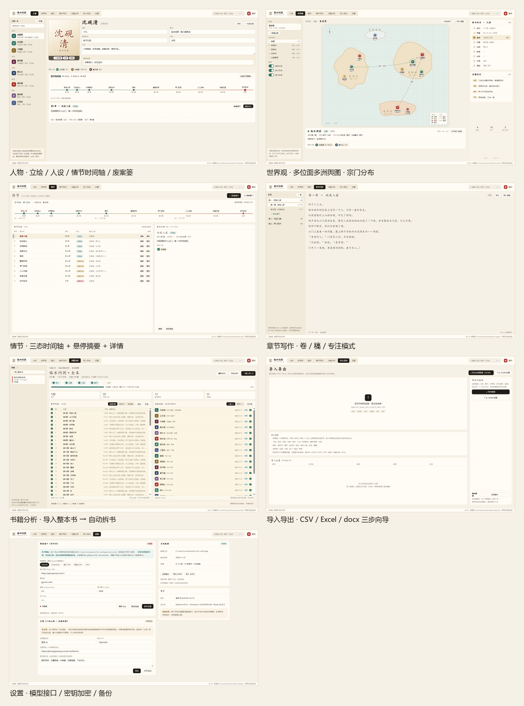
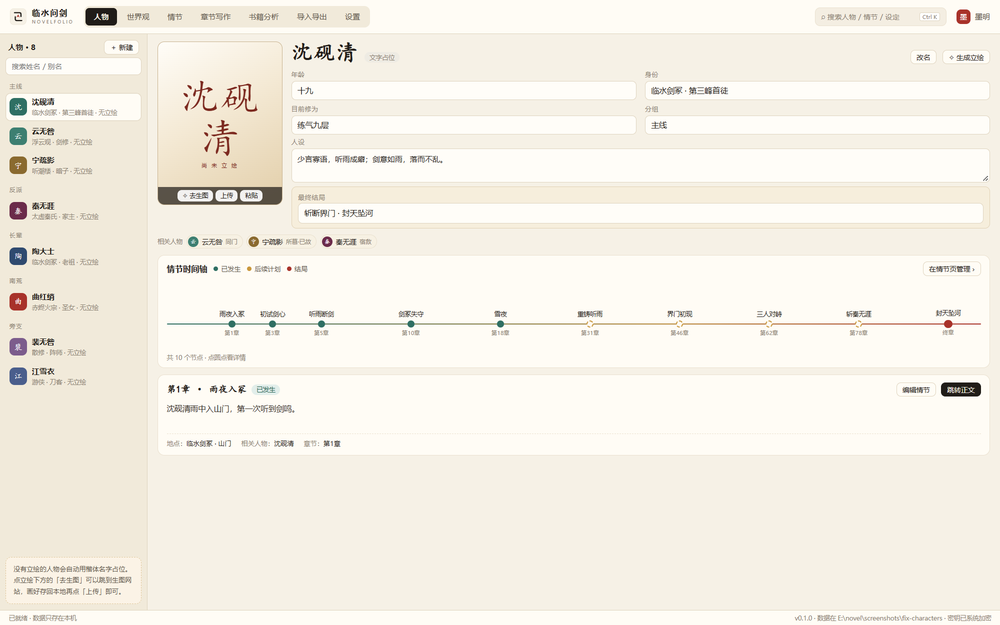
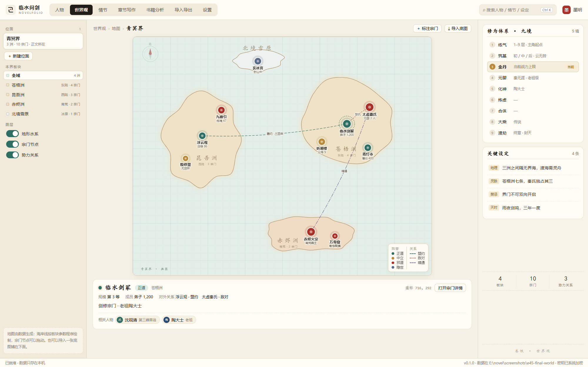
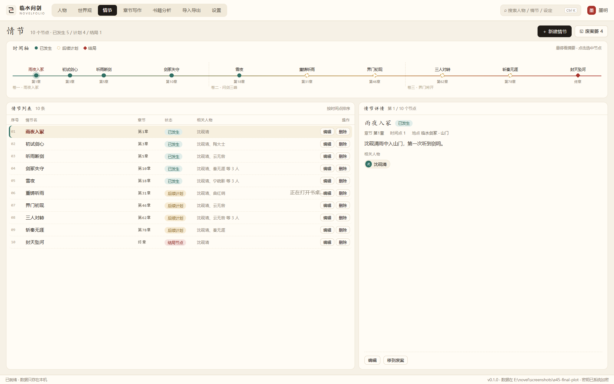
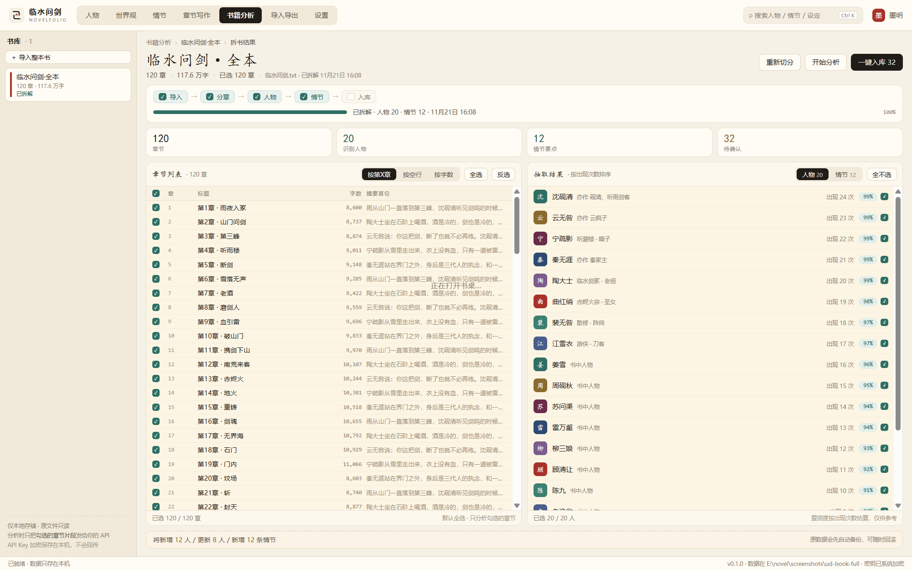
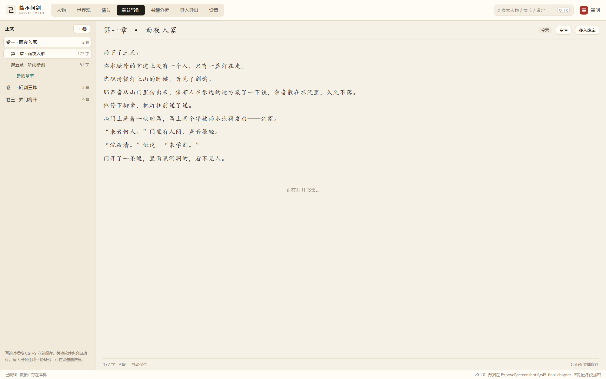
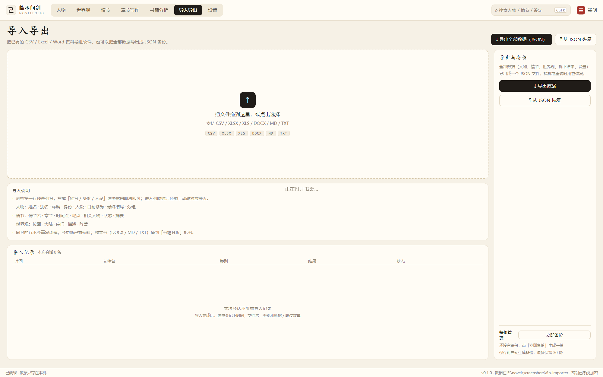

# 卷帙 NovelFolio

离线优先的中文长篇小说创作工作台。人物、世界观、情节、正文、拆书、导入导出，六个入口串成一条从素材到成稿的链路。

界面是「纸间书桌」风格：暖纸底、墨色字、印章红点缀、楷体标题。

> **下载 Windows 版**：[卷帙 NovelFolio v0.1.0 · 免安装 exe](https://github.com/Andrianxu/novel-create/releases/latest)（约 105 MB，双击即用，无需装 Node）
>
> 设计稿在 `previews/`（界面预览 + 演示文稿），Logo 与图标在 `logo/`，实际运行截图在 `docs/screenshots/`。

## 界面



| | |
| --- | --- |
|  |  |
| 立绘、人设字段、三态情节时间轴、废案篓 | 多位面舆图、可拖动宗门节点、修为体系 |
|  |  |
| 时间轴 + 悬停摘要 + 详情 + 废案回收站 | 导入整本书 → 自动分章 → 抽人物/情节 → 一键入库 |
|  |  |
| 卷·篇目录、楷体编辑器、自动保存、专注模式 | CSV / Excel / docx 三步导入向导 |

---

## 现在能做什么

| 模块 | 状态 | 说明 |
| --- | --- | --- |
| 人物 | 可用 | 立绘 / 楷体名字占位、年龄 / 人设 / 身份 / 目前修为 / 最终结局、情节时间轴三态（悬停看摘要、点击看详情并跳相关人物）、废案篓 |
| 世界观 | 可用 | 位面下拉（多位面各自一份舆图）、数据驱动 SVG 多洲地图（大陆由数据算出海岸线）、宗门节点可拖动并与关系线实时重绘、四大阵营配色、修为体系、关键设定、可导入底图叠加 |
| 情节 | 可用 | 三态时间轴（已发生 / 后续计划 / 结局）+ 列表 + 详情 + 悬停气泡、分卷刻度、废案回收站（恢复 / 彻底删除 / 90 天保留期） |
| 章节写作 | 可用 | 卷 / 篇目录、正文编辑器、字数统计、自动保存、专注模式、移到废案 |
| 书籍分析（拆书） | 可用 | 导入整本书 → 自动分章（三种规则）→ 调你自己的大模型 API 抽人物 / 情节 → 勾选入库，全程可取消、进度实时 |
| 导入导出 | 可用 | CSV / XLSX / XLS / DOCX / MD / TXT 三步导入向导（列映射、逐行校验、只导入勾选行）、JSON 整库导出与恢复、备份管理 |
| 生图 | 半自动 | 一键拼提示词 → 打开你配置的生图网站 / 本地程序 → 把图拖回来设成立绘 |

快捷键：`Ctrl/⌘ + K` 快速跳转（人物 / 情节 / 宗门全局搜索），`Ctrl/⌘ + S` 立即保存。

## 运行

```bash
npm install
npm start
```

需要 **Node.js 22.12+**（Electron 45 的运行时下载脚本要求这个版本）。`npm install` 会自动把 Electron 运行时下载到 `node_modules/electron/dist`；国内网络慢可以先设镜像：

```powershell
$env:ELECTRON_MIRROR = "https://npmmirror.com/mirrors/electron/"
npm install
```

首次启动会在用户数据目录生成一份演示数据（一本叫《临水问剑》的书），可以直接改，也可以「设置 → 导入 JSON」换成你自己的。

### 打包成 Windows 程序

```bash
npm install
npm run dist          # 出 dist/NovelFolio-0.1.0-portable.exe，双击就能开，不用装 Node
npm run dist:nsis     # 走安装向导的版本（可选）
```

打包产物在 `dist/`，不进仓库。

仓库自带 GitHub Actions（`.github/workflows/build.yml`）：每次推到 `main` 都会在 windows-latest 上跑一次打包，成功后在 Actions 页面的 Artifacts 里就能下载 `NovelFolio-Windows.zip`（里面是同一个免安装 exe），不用本机装 Node。

第一次打包要下载 NSIS 等工具链，国内网络可能卡在 GitHub 上，可以先设镜像：

```powershell
$env:ELECTRON_BUILDER_BINARIES_MIRROR = "https://npmmirror.com/mirrors/electron-builder-binaries/"
npm run dist
```

## 已知限制

- 拆书必须自己配一个 OpenAI 兼容接口；没配 Key 时页面只显示引导卡，不会发任何请求。
- 生图是「拼提示词 + 打开网站 + 收图入库」，不内置模型；本地 SD WebUI / ComfyUI 需要自行扩展一个 HTTP 调用。
- 拖拽导入 Excel / Word 依赖 Electron 的 `webUtils.getPathForFile`（`preload.js` 已暴露 `files.pathFor`），不支持的文件会提示改用「点击选择」。
- 章节编辑目前是纯文本，没有富文本、批注和版本对比（在路线图里）。

## 数据存在哪

全部在 Electron 的 userData 目录，**不在项目里**：

| 平台 | 路径 |
| --- | --- |
| Windows | `%APPDATA%\\novelfolio\\` |
| macOS | `~/Library/Application Support/novelfolio/` |

```
novelfolio/
├─ config.json            接口地址、模型、生图设置（不含密钥）
├─ secrets.bin            API Key（系统 DPAPI / Keychain 加密）
├─ data/
│  ├─ novelfolio.data.json 全部作品数据
│  ├─ backups/             自动备份，最多 30 份
│  ├─ portraits/           立绘图片
│  ├─ maps/                地图底图
│  └─ books/               拆书用到的原文本地缓存
```

## 关于 API Key 和隐私（重要）

拆书要用大模型，但**仓库里永远不会有你的 Key**：

1. Key 只存在上面那个 `secrets.bin` 里，用系统级加密（Windows DPAPI / macOS Keychain）保护；
2. Key 存在 `userData`，不在项目目录，`.gitignore` 已经屏蔽了所有可能的密钥文件；
3. Key 不会回传到界面（界面只显示 `sk-1234****abcd` 这样的掩码），也不会写进日志；
4. 也支持用环境变量 `NF_API_KEY` 临时覆盖，适合 CI 或不想落盘的情况；
5. 拆书时只把**你在页面上勾选的那些章节片段**发给你自己配置的接口，不发往任何其他地方；软件没有账号、没有埋点、没有崩溃上报。

> 克隆这个仓库的人，需要自己在「设置 → 模型接口」里填地址、模型名和 Key 才能用拆书。其余功能完全离线可用。

### 接口要求

任何 **OpenAI 兼容**的 `/chat/completions` 接口都可以，内置了几个常用预设：

| 服务 | Base URL | 模型示例 |
| --- | --- | --- |
| OpenAI | `https://api.openai.com/v1` | `gpt-4o-mini` |
| DeepSeek | `https://api.deepseek.com/v1` | `deepseek-chat` |
| 通义千问 | `https://dashscope.aliyuncs.com/compatible-mode/v1` | `qwen-plus` |
| 智谱 GLM | `https://open.bigmodel.cn/api/paas/v4` | `glm-4-flash` |
| Kimi | `https://api.moonshot.cn/v1` | `moonshot-v1-8k` |

内置的只是快捷方式，**模型名那一栏本来就可以手填任意值**；想长期留着自己的服务，在「设置 → 模型接口」里点胶囊行末尾的「＋ 自定义模型」：

- 填「名称 / Base URL / 模型名」三件事，点「保存并选用」后它就和内置预设一样待在常用服务里，点一下即可切换（本地 Ollama `http://127.0.0.1:11434/v1`、LM Studio、vLLM、one-api / new-api 这类中转都行）；
- 同名再存一次就是改那一条，不会堆出重复项；胶囊右边的 ✕ 只删这条快捷方式，已经填好的地址、模型名和 API Key 都不动；
- 模型名右侧的「读取模型列表」会请求该接口的 `GET /models`（OpenAI 兼容接口基本都有），把拿到的模型名放进输入框的候选里，点一下就能挑，不用背模型名；
- 这些自定义项存在 `userData/config.json` 的 `llm.customModels` 里，和 Key 一样只在本机。

## 生图怎么接

软件本身不训练模型，只负责「拼提示词 → 打开工具 → 收图入库」：

1. 在人物页点立绘下方的「去生图」；
2. 软件把 `姓名 + 年龄 + 身份 + 人设 + 你设的画风 + 尺寸` 拼成提示词放进剪贴板，并打开你在设置里填的生图网站（即梦 / 通义万相 / Bing / Liblib 都行），或者本地程序；
3. 画好后把图存到本地，回到软件点「上传」，或直接「粘贴」剪贴板里的图。

想接本地 Stable Diffusion WebUI / ComfyUI 的 API 也能扩展（它们都是 `127.0.0.1` 上的 HTTP 服务），但默认不做，保持零依赖。

## 开发

```bash
npm start                       # 启动
node --version                  # 需要 18+
```

运行时是 **Electron 45**（Chromium 内置，不额外引入前端框架）。`npm audit` 里剩下的 moderate 全部来自 `electron-builder` 的构建期依赖（`minimatch` 的 ReDoS），只在你自己打包时执行，不会进 exe、不影响运行时；升级到 Electron 45 后已没有 high / critical。

项目结构（渲染层是**零依赖原生 ES 模块**，没有 React / 没有打包器）：

```
app/
├─ main.js              Electron 主进程：窗口、IPC、拆书流水线
├─ preload.js           contextBridge，暴露 window.nf
├─ lib/
│  ├─ paths.js          数据目录
│  ├─ store.js          JSON 存储 + 原子写 + 备份轮换
│  ├─ settings.js       配置与密钥（safeStorage 加密）
│  ├─ llm.js            OpenAI 兼容客户端、稳健 JSON 抽取、重试
│  ├─ parse.js          CSV / DOCX / XLSX 解析、按「第X章」切分
│  ├─ zipread.js        零依赖 zip 读取（docx/xlsx 用）
│  └─ seed.js           首次启动的演示数据
└─ renderer/
   ├─ index.html
   ├─ css/app.css       设计系统
   └─ js/
      ├─ app.js         外壳、路由、快捷键
      ├─ util.js        h() / toast() / modal() / injectStyle() 等
      └─ pages/         每个页面一个 ES 模块
```

### 调试 / 自动化检查

主进程带了一组只在开发时用的命令行开关（都不影响正常启动）：

| 开关 | 作用 |
| --- | --- |
| `--page=world` | 启动后直接跳到某个模块 |
| `--shot=out.png` | 截图后退出 |
| `--probe=out.json` | 导出 `[data-probe]` 元素的坐标与滚动状态 |
| `--eval=test.js` `--out=r.json` | 在渲染层跑一段脚本（可 await），结果写进 json |
| `--click=x,y` | 用**真实鼠标事件**点一下屏幕坐标（走命中测试，能发现「被透明遮罩挡住」这类问题） |
| `--ud=dir` | 换一个用户数据目录，方便反复试 |

```powershell
$env:ELECTRON_RUN_AS_NODE = ""   # 必须在普通 shell 里用，别让 electron 当 node 跑
.\node_modules\electron\dist\electron.exe . --ud=tmp --click=221,27 --eval=test.js --out=r.json
```

页面契约：

```js
export default {
  id: 'characters',
  label: '人物',
  statusText(doc) { return '人物 ' + doc.characters.length; },
  mount(root, ctx) { /* ctx = { doc, params, NF } */ }
};
```

## 路线图

- [x] 打包成安装包（electron-builder，出 `.exe`，写进 `dist/`，不进仓库）
- [ ] 章节内联批注与版本对比
- [ ] 拆书支持 EPUB，支持中断续跑
- [ ] 时间轴拖拽排序、卷轴视图
- [ ] 关系图谱可视化（人物 / 宗门共用一套布局算法）
- [ ] 可选：接本地 Stable Diffusion / ComfyUI 的 HTTP 接口直接出图

## 许可

MIT
