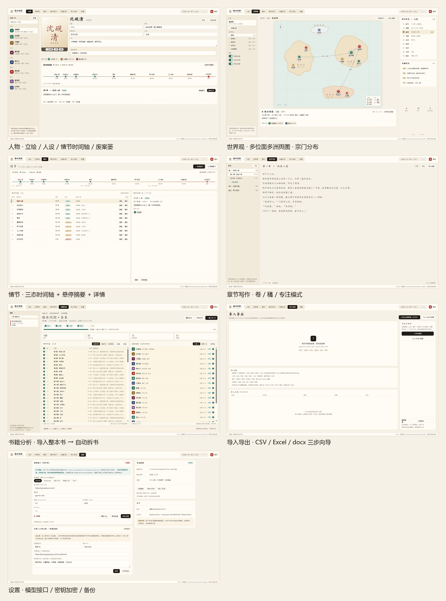

# 卷帙 NovelFolio · v0.1.0

> **离线优先的中文长篇小说创作工作台。** 人物、世界观、情节、正文、拆书、导入导出 —— 从素材到成稿的一条完整链路，全部装进一个 105 MB 的免安装 exe 里。



---

## 一句话

写长篇最难的不是写，是**记住**：谁在第几章说过什么、这条暗线什么时候该收、这个人物的设定有没有前后矛盾。卷帙把这些拆成「人物 / 世界观 / 情节 / 章节」四块结构化数据，让正文、设定、时间线互相对得上；再用「拆书」把现成的整本书反向喂进来，一键长成一套可编辑的骨架。

**没有账号、没有云、没有埋点。** 数据全在本机，AI 只发给你自己配置的接口。

---

## 七个入口

| | 模块 | 它解决什么 |
| --- | --- | --- |
| 👤 | **人物** | 立绘、年龄、人设、身份、目前修为、最终结局；每个人物自带一条「情节时间轴」，一眼看出他什么时候出场、什么时候死 |
| 🗺 | **世界观** | 多位面舆图，数据驱动的 SVG 多洲地图（海岸线由数据算出），宗门节点可拖动、关系线实时重绘；修为体系、关键设定、可导入底图叠加 |
| 🧭 | **情节** | 带刻度的时间轴 + 主线多层嵌套暗线；暗线有「引出点 / 收敛点」，以树状枝分叉、再收敛回父线；滚轮缩放、拖拽定格、AI 构思助手 |
| ✍ | **章节写作** | 卷 · 篇目录 + 楷体编辑器；点情节在正文里用「荧光玻璃」标出对应段落；AI 写作助手直接续写进正文 |
| 📚 | **书籍分析（拆书）** | 导入整本书 → 自动分章 → 调你自己的大模型抽人物 / 情节 → 勾选入库 |
| 📥 | **导入导出** | CSV / XLSX / DOCX / MD / TXT 三步导入向导；JSON 整库导出与恢复；自动备份 |
| 🎨 | **生图** | 一键拼提示词 → 打开你配置的生图网站 → 把图拖回来设成立绘 |

---

## 这一版做了什么

### 📝 章节写作

- **「＋ 新的章节」固定在侧栏顶部**，不再藏在列表最后
- **新建章节弹窗**：自己填「第几章 + 标题名」。章号已有就按该号插进去、后面的章节自动顺延，标题名一律保留；填超过现有章数的号，就当末尾新增，不补空号
- **点章节行收起 / 展开该章的情节**，各章状态独立，收起时留一行「情节 N 条已收起 · 展开」
- **点情节 → 正文里那一段被「荧光玻璃」标出**：比纸色沉一档的暖琥珀底色 + 上下细亮边 + 落下时亮一下再极缓呼吸。只加底色，不改字色、不加描边、不选中文字、不弹说明条；**再点同一条情节即收起**
- 卷内按章号排序，手写的「第五章」和自动生成的「第八章」能排在一起

### 🧭 情节时间轴

- 圆点严格串在刻度轴上；拖动不吸附、松手按落点定格
- 滚轮横向缩放（以鼠标处为锚点）+ Shift 平移 + 「实际用到 / 全部」
- 主线 + 任意多级嵌套暗线，暗线的引出 / 收敛端点是父线上的可拖圆点，双击复位为「跟随情节」
- 空暗线不画线；环状数据自动回退挂主线，不崩

### 🔐 隐私与成本

- API Key 只在本机 `secrets.bin`，系统级加密（Windows DPAPI / macOS Keychain），界面永远只显示 `sk-1234****abcd`
- 不发往任何第三方，无账号、无埋点、无崩溃上报
- 模型调用带上你自己设的 `temperature` 与单次 `max_tokens` 上限

---

## 快速开始

**Windows 用户**：下载 [NovelFolio-0.1.0-portable.exe](https://github.com/Andrianxu/novel-create/releases/latest)，双击即用，无需安装 Node。

**开发者**：

```bash
npm install
npm start          # 需要 Node.js 22.12+
```

首次启动会生成一部演示小说《临水问剑》，可以直接改，也可以从「设置 → 导入 JSON」换成你自己的。

打包：

```bash
npm run dist       # dist/NovelFolio-0.1.0-portable.exe
npm run dist:nsis  # 走安装向导的版本
```

---

## 接口要求

任何 **OpenAI 兼容** 的 `/chat/completions` 接口都能用，内置预设：

| 服务 | Base URL | 模型示例 |
| --- | --- | --- |
| OpenAI | `https://api.openai.com/v1` | `gpt-4o-mini` |
| DeepSeek | `https://api.deepseek.com/v1` | `deepseek-chat` |
| 通义千问 | `https://dashscope.aliyuncs.com/compatible-mode/v1` | `qwen-plus` |
| 智谱 GLM | `https://open.bigmodel.cn/api/paas/v4` | `glm-4-flash` |
| Kimi | `https://api.moonshot.cn/v1` | `moonshot-v1-8k` |

本地 Ollama / LM Studio / vLLM / one-api 这类中转也支持，模型名可以手填任意值。

---

## 已知限制

- 拆书必须自己配一个 OpenAI 兼容接口；没配 Key 时页面只显示引导卡，不会发任何请求
- 生图是「拼提示词 + 打开网站 + 收图入库」，不内置模型
- 章节编辑目前是纯文本，没有富文本、批注和版本对比
- 只在 Windows 上打包；macOS / Linux 需自行构建

---

## 技术栈

Electron 45 · 渲染层原生 ES 模块（**零前端依赖**，没有 React、没有打包器）· 主进程 CommonJS · 数据为单个 JSON 原子写 + 自动备份轮换

```
app/
├─ main.js              Electron 主进程：窗口、IPC、拆书流水线
├─ preload.js           contextBridge，暴露 window.nf
├─ lib/                 存储 / 配置与密钥 / LLM 客户端 / 解析 / 种子数据
└─ renderer/
   ├─ css/app.css       设计系统
   └─ js/               app.js 外壳 · util.js · undo.js 全篇撤销 · pages/ 每页一个模块
```

---

## 设计

界面是「纸间书桌」：暖纸底 `#F6F1E6`、墨色字 `#201C18`、印章红 `#A8322A`、楷体标题。所有交互都往「纸上的墨」靠 —— 连高亮都是一层压在纸上的荧光玻璃，而不是一条荧光笔。

---

## 许可

MIT · 数据只保存在本机
